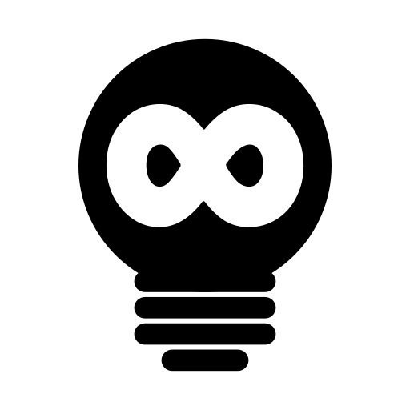

<p align="center">
  
</p>

<h1 align="center">Keep Screen On</h1>

<p align="center">
  Un simple interrupteur Android pour garder l’écran allumé, indéfiniment.<br>
  Pas d’écran, pas de notification, pas de publicité.
</p>

<p align="center">
  
  
  
</p>

---

## Fonctionnement

Keep Screen On n’a aucune interface. Il suffit de l’ouvrir :

1. **Premier lancement** : l’écran reste allumé, sans limite de durée. L’application se ferme aussitôt et n’apparaît pas dans les applications récentes.
2. **Lancement suivant** : le délai de veille d’origine est rétabli.

Un court message à l’écran indique si le maintien vient d’être activé ou annulé.

## Points clés

- **Un seul geste** : ouvrir l’application, c’est tout.
- **Aucune notification** et aucun service en arrière-plan.
- **Aucune publicité, aucun achat intégré, aucun traqueur.**
- **Aucune permission Internet** : l’application ne peut rien envoyer.
- **Icône adaptative** avec prise en charge des icônes thématiques (Android 13+).
- **Nom traduit** selon la langue du téléphone : français, anglais, espagnol, allemand, italien, portugais et néerlandais.

## Permission requise

Une seule : **« Modifier les paramètres système »** (`WRITE_SETTINGS`), qui sert à régler le délai de mise en veille. Android l’affiche au premier lancement : activez-la pour l’application, puis relancez-la.

## Comment ça marche

L’application règle `Settings.System.SCREEN_OFF_TIMEOUT` à sa valeur maximale et mémorise la valeur précédente pour la restaurer au lancement suivant.

> [!NOTE]
> Comme il s’agit d’un réglage système, le maintien persiste jusqu’à ce que vous relanciez l’application, même après un redémarrage. Si vous la désinstallez pendant qu’elle est active, remettez le délai à la main dans **Réglages > Affichage**.

## Compilation

Prérequis : Android Studio (ou JDK 17 et le SDK Android).

| Élément | Version |
| --- | --- |
| Application | 1.0.0 (`versionCode` 1) |
| Gradle | 9.9.1 |
| Plugin Android (AGP) | 9.5.0 |
| Android minimum / cible | 7.0 (API 24) / API 36 |

```bash
./gradlew assembleDebug
```

L’APK est généré dans `app/build/outputs/apk/debug/`. La version est définie dans `app/build.gradle.kts` (`versionName` et `versionCode`) et reprise automatiquement dans le manifeste Android.

## Bibliothèques utilisées

| Bibliothèque | Licence |
| --- | --- |
| [AndroidX Core](https://developer.android.com/jetpack/androidx/releases/core) | Apache License 2.0 |

---

## English

**Keep Screen On** is a tiny Android app that keeps your screen on indefinitely. Open it once: the screen stays on. Open it again: the normal timeout is restored. No UI, no notification, no ads, no internet permission, no background service. It only needs the *Modify system settings* permission to set the screen timeout. The app name is translated into your phone's language.
